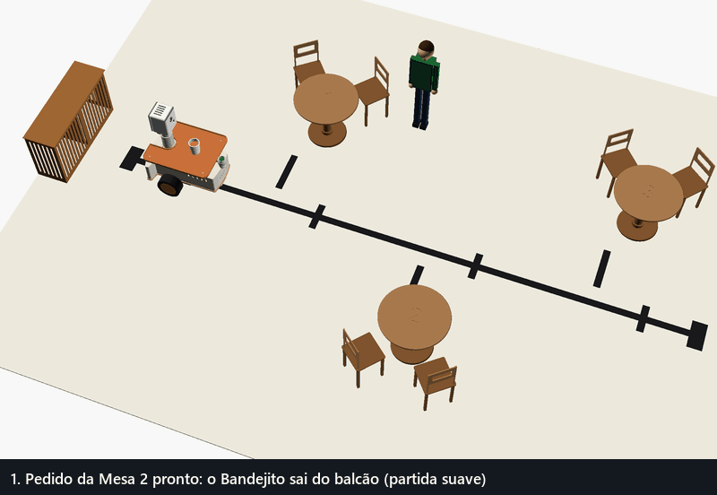
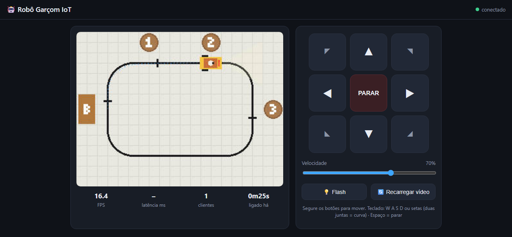
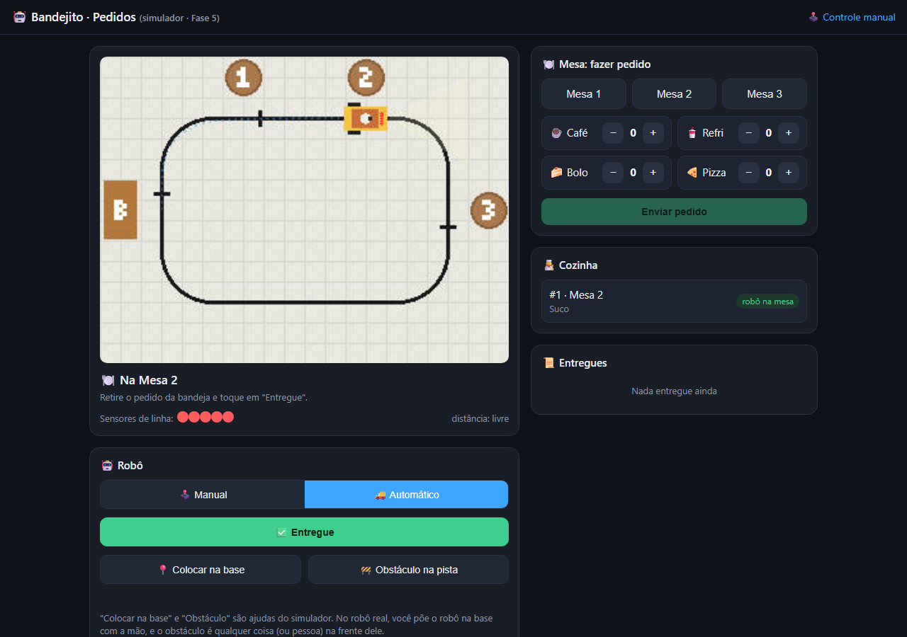

<h1 align="center">Olá! Eu sou Rin&lt;code&gt; 👋</h1>

  Aprendendo <b>IoT</b>, <b>sistemas embarcados</b> e <b>desenvolvimento web</b> construindo projetos de verdade. 
  🎯 <b>Aberto a oportunidades de estágio.</b>

---

## 🤖 Projeto em destaque: Bandejito 1.0

**Robô garçom em miniatura com ESP32-CAM**: vídeo ao vivo e controle pelo navegador, simulador completo no PC e um modo autônomo que segue uma fita no chão até a mesa certa, vira de frente para ela, avisa por voz e volta para o balcão quando o cliente aperta o botão verde.

  
  

- 📡 O robô cria a própria rede Wi-Fi e serve um painel web com vídeo MJPEG
- 🛑 Parada de segurança automática se a conexão cair e partida suave (o robô alto não "empina")
- 🖥️ Simulador em Node.js com a mesma API do firmware, para testar sem hardware
- 🧭 Seguidor de linha com controle PD, giro de 90° até a mesa, mensagem de voz, botão verde, fila de pedidos e freio diante de obstáculos (no simulador)
- 🖨️ Carcaça 3D paramétrica gerada por código (CadQuery/OpenSCAD), com bandejas, portinhas de encaixe e pé antitombo, validada no modelo (colisões e centro de massa)

| Painel de controle (vídeo ao vivo + direção) | Página de pedidos (modo autônomo) |
|---|---|
|  |  |

👉 **[Ver o repositório](https://github.com/rincode-dev/robo-garcom-iot)** · Status: software pronto e testado no simulador; principais peças compradas, montagem do robô físico em seguida.

---

## 🛠️ Tecnologias que usei

